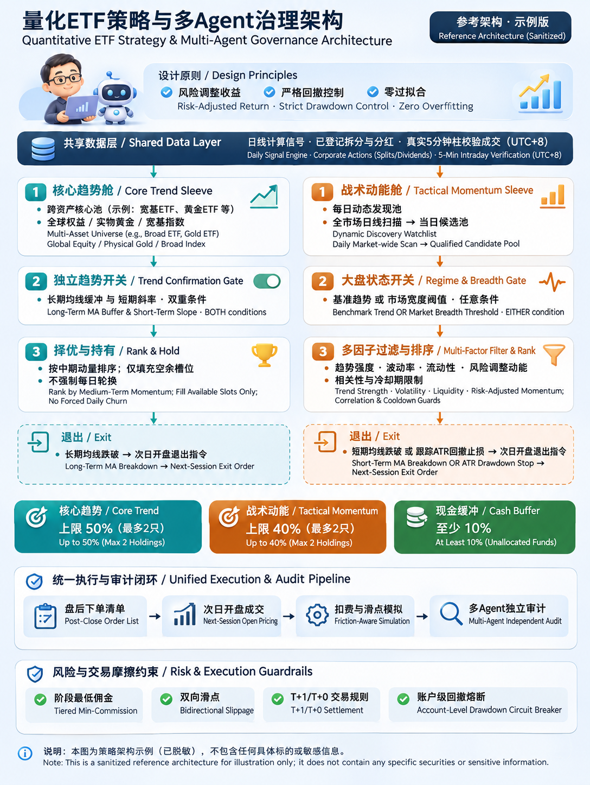
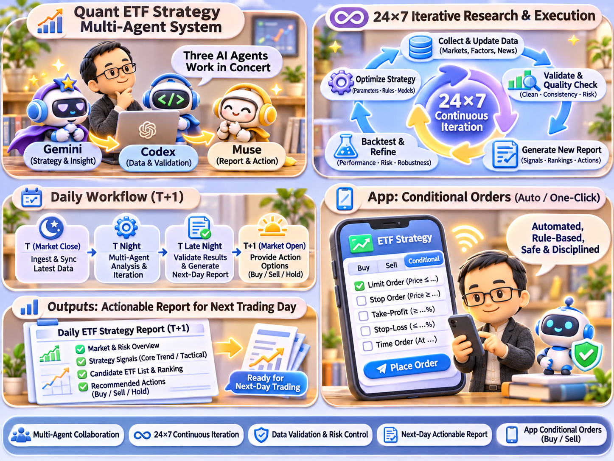

# Quantitative ETF Strategy & Multi-Agent Governance Architecture
# 量化 ETF 策略与多智能体（Multi-Agent）独立审计参考架构



> **Disclaimer / 免责声明:** This repository documents the system architecture, execution friction modeling, and multi-agent governance framework of an automated quantitative ETF research sandbox. Specific ticker symbols, threshold parameters, and private infrastructure endpoints have been redacted. Nothing herein constitutes financial advice or a guarantee of future returns.  
> 本仓库仅展示自动化量化 ETF 研究沙盒的系统架构、交易摩擦建模与多 Agent 治理闭环。所有具体标的代码、敏感参数阈值及私有内网节点均已脱敏处理，不构成任何投资建议或收益承诺。

---

## 1. Executive Overview | 项目概述

Designed and deployed on a low-power, 24/7 **2-Bay Synology NAS** edge server, this system implements an end-to-end, fully automated **Core-Satellite quantitative ETF trading & paper-trading sandbox**. 

Rather than relying on black-box predictions or curve-fitted historical parameters, the project emphasizes **institutional-grade engineering governance**: strict separation of risk sleeves, realistic microstructure friction modeling, cryptographic order sealing, and **Tri-Agent Separation of Duties** (Human Quant Architect + Strategy Advisory Agent + Code Execution Agent + Independent Compliance Audit Agent).

本系统部署于低功耗、7×24 小时无人值守的**双盘位 Synology NAS** 边缘节点，构建了一套端到端全自动运行的**“核心—卫星（Core-Satellite）”量化 ETF 研究与沙盒模拟引擎**。项目摒弃过度拟合的历史参数调优，专注于**机构级工程治理**：双舱风险隔离、真实市场微观结构摩擦仿真、订单哈希封存，以及**多智能体权责分离闭环**（人类架构师 + 策略参谋 Agent + 工程实现 Agent + 独立合规审计 Agent）。

---

## 2. Core Architectural Pillars | 核心架构支柱

### 2.1 Core-Satellite Asset Allocation | 核心—卫星双舱资产配置
Capital is partitioned into three isolated sleeves with **Target Allocation Caps** (maximum risk ceilings rather than forced full-investment mandates):

* **Core Trend Sleeve (Up to 50%, Max 2 Holdings) | 核心趋势舱（上限 50%，最多 2 只）：**
  * **Universe:** Cross-asset low-correlation core instruments (e.g., Global Equity, Physical Gold, Broad Market Index).
  * **Entry & Exit:** Independent long-term Moving Average buffer breakout + short-term slope confirmation; exits upon long-term MA breakdown. Operates independently of short-term tactical breadth switches.
* **Tactical Momentum Sleeve (Up to 40%, Max 2 Holdings) | 战术动能舱（上限 40%，最多 2 只）：**
  * **Universe:** Dynamic candidate pool generated by a daily market-wide discovery scanner.
  * **Regime & Breadth Gate:** New entries are permitted only when either the benchmark index trends above its moving average **OR** overall market breadth exceeds a minimum threshold.
  * **Multi-Factor Filter:** Combines trend strength (`ADX` gate), volatility comfort band (`ATR%`), minimum daily liquidity floor, sector correlation deduplication, cooldown guards, and risk-adjusted momentum ranking (`Return / ATR%`).
  * **Anti-Churn Discipline:** Existing holdings are **never** forcibly rotated merely due to daily rank shifts; qualified candidates only fill vacant slots after an exit signal (`MA` breakdown or trailing `ATR` drawdown stop).
* **Cash Buffer & Yield Proxy (At Least 10%) | 现金缓冲（至少 10%）：**
  * Unallocated capital automatically remains in cash and accrues daily money-market proxy returns during weak or sideways market regimes.

---

### 2.2 Realistic Microstructure & Friction Simulation | 真实交易摩擦仿真
To prevent paper-trading illusions, every simulated fill enforces real-world execution constraints:
* **No Look-Ahead Bias:** Post-close batch settlement reads the **actual first 5-minute opening bar** of the execution day rather than idealized daily close prices.
* **Tiered Commission & Bidirectional Slippage:** Applies tiered minimum-floor commission plus bidirectional basis-point slippage on every simulated fill.
* **Settlement & Lot Constraints:** Enforces standard minimum lot rounding, domestic `T+1` holding locks (defaulting unknown cross-border mappings conservatively to `T+1`), and halts execution if no valid opening quote exists.
* **Account-Level Circuit Breaker:** Automatically halts new entries if cumulative sandbox drawdown hits the predefined risk threshold.

---

## 3. Multi-Agent Governance Workflow | 多智能体协同与独立审计闭环



```text
+-------------------------------------------------------------------------+
|                 Human Quant Architect (Top-Level Design)                |
|        Defines Risk Caps, Microstructure Rules & Audit Guardrails       |
+------------------------------------+------------------------------------+
                                     |
         +---------------------------+---------------------------+
         v                           v                           v
+-----------------+         +-----------------+         +-----------------+
|  Gemini Agent   |         |   Codex Agent   |         |   Muse Agent    |
| Strategy & Risk |         | Data Pipeline & |         |   Independent   |
|    Advisory     |         | Engine Builder  |         | Compliance Audit|
+--------+--------+         +--------+--------+         +--------+--------+
         |                           |                           |
         +-------------> [ Synology 2-Bay NAS Runtime ] <--------+
                                     |
         +---------------------------+---------------------------+
         v                                                       v
[ Post-Close Batch Engine ]                             [ Out-of-Sample Sandbox ]
 • Corporate Action Adj.                                 • SHA-256 Order Sealing
 • Discovery Funnel Scan                                 • Next-Session 5m Open Fill
 • Ledger & State Update                                 • Independent Sign-Off
```

1. **Cryptographic Order Sealing (`SHA-256`):** Next-session order lists are generated post-close, timestamped, and sealed with a SHA-256 hash prior to market open to guarantee auditability and prevent retroactive tampering.
2. **Separation of Duties:** The execution engine (`Codex` pipeline) and the compliance auditor (`Muse` verification check) operate on decoupled state logs, ensuring strict adherence to locked sandbox rules without parameter drift.

---

## 4. Recommended Repository Structure | 推荐仓库目录结构

```text
quant-etf-multi-agent-architecture/
├── README.md                          # Bilingual system documentation (this file)
├── docs/
│   ├── architecture_sanitized.png     # Sanitized bilingual architecture diagram
│   ├── workflow_comic.png             # Visual overview of multi-agent NAS workflow
│   └── dashboard_demo.html            # Static sanitized UI preview (normalized NAV = 1.0000)
├── schemas/
│   ├── order_seal.schema.json         # JSON contract for timestamped & hashed order plans
│   └── audit_report.schema.json       # JSON contract for independent agent compliance sign-off
└── specs/
    └── governance_and_risk.md         # Detailed engineering specification of friction & circuit breakers
```

---

## 5. Tech Stack | 技术栈

* **Infrastructure:** Synology DiskStation (Compact 2-Bay NAS), Linux Cron Scheduler, Tailscale Mesh VPN (private management), Cloud Storage Sync.
* **Data & Quantitative Engine:** Python (`pandas`, `numpy`), Event-Driven Corporate Action Adjustments (Splits & Dividends), Multi-Factor Screening Pipeline.
* **Governance & UI:** SHA-256 Integrity Verification, JSON State Contracts, Lightweight Static HTML/CSS Telemetry Dashboard.
